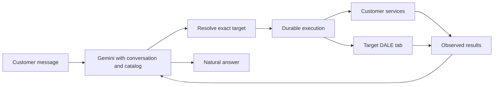

# Implementation plan

DALE conversational website control — implementation handover, 20 October 2026.

**Implementation authorized, 20 October 2026.** Progress and evidence are tracked in [the execution ledger](docs/WEBSITE_CONTROL_STATUS.md) and [control coverage inventory](docs/website-control-coverage.json). This plan describes the complete target; implemented capabilities must be qualified individually.

**Local implementation checkpoint, 21 October:** customer website control is implemented through `3507760`, including real browser tabs, customer workflows, voice transport and durable recovery. The ledger records 25 distinct browser journeys, targeted contracts and live Gemini samples. [Repository regression triage](docs/WEBSITE_CONTROL_REGRESSION_TRIAGE.md) records the separate catalog/media gate that still prevents a whole-marketplace production certification. No hosted rollout is implied by the local checkpoint.

## 1. Product objective

Make conversation a practical way to operate DALE's customer-facing website. A shopper should discover products, navigate, open several product tabs, select an exact item, manage a basket, compare choices, and use existing customer workflows by typing what they want. Success is an observed result in the actual application.

Preserve natural Gemini conversation, catalog RAG, session memory, and the current visual design. Add capabilities and reliable execution. Do not introduce reply templates, keyword-based conversational routing, a new personality layer, or prescribed prompt sequences. Gemini chooses its language and useful actions.

The explicit multi-tab requirement is first-class: “Open an iPhone in a new tab and a Samsung in another” must produce independently observed DALE product pages when permitted by the browser. Mentioning products, returning links, or receiving window handles does not complete the action.

“Everything” means every applicable operation on DALE's actual customer interface, tracked in a coverage inventory. This scope does not add unrelated marketplace features, expose seller/reviewer controls, or grant control of browser settings and arbitrary external websites.

## 2. Authority and saved baseline

Read in order:

1. This implementation plan.
2. [Checkpoint audit](docs/CHECKPOINT_2026-10-20.md): qualification and known broader test failures.
3. [Catalog RAG](docs/CATALOG_RAG.md) and [session memory](docs/SESSION_MEMORY.md): working behavior to preserve.
4. [MASTER_PLAN](MASTER_PLAN.md): original customer-first capabilities and historical decisions.
5. [Archived assortment implementation plan](CATALOG_IMPLEMENTATION_PLAN_2026-10-11.md) and [assortment specification](docs/ASSORTMENT_DEPTH_MASTER_PLAN.md): preserved catalog requirements, not claims of completed coverage.

The application checkpoint is `e2fb7a2`, following Gemini/RAG/memory work through `6fc0069`. It was pushed before this plan revision to the configured DALE repository. Development is now consolidated on `main`. Reinspect the remote, instructions, log, and working tree before implementation; other agents may have continued work.

Preserve customer/guest identities, conversations, orders, groups, quotes, approvals, payment/evidence records, product IDs, provider settings, and existing layouts. Use additive migrations. Do not reset databases, blanket reseed, automatically restore deleted categories, force-push, or overwrite unrelated work.

Existing credentials are private and already configured. Do not ask for them again without a demonstrated dependency. Do not enable billing, silently switch models, add paid infrastructure, or require EC2 access before proving local behavior.

## 3. Current implementation seams

| Foundation             | Existing location                                                              | Treatment                                                                           |
| ---------------------- | ------------------------------------------------------------------------------ | ----------------------------------------------------------------------------------- |
| Gemini and catalog RAG | `src/server/concierge/model.ts`, `catalog-rag.ts`, `retrieval.ts`              | Preserve natural answers, retrieval, native call IDs and continuation signatures.   |
| Conversation archive   | `memory.ts`, `store.ts`                                                        | Preserve history. Store active action continuation separately from prose summaries. |
| Destinations           | `src/domain/site-routes.ts`                                                    | Resolve actual routes and entity IDs from application data.                         |
| Browser bridge         | `src/components/copilot/copilot-context.tsx`, action API, `acknowledgeBrowser` | Reuse after auditing tab targeting, readiness, and recovery.                        |
| Customer services      | `src/server/concierge/shopping.ts`, commerce/group/order services              | Share the business behavior of manual controls.                                     |
| Older tool definitions | `src/server/concierge/tools.ts`                                                | Reuse appropriate service bodies; do not enable the entire old tool/prompt stack.   |

Important gaps to handle explicitly:

- The current RAG loop is read-only and its tool observations are transient. Adding an action name alone will not support durable pause/resume after navigation.
- Old tab execution treats returned window handles as success without inspecting the loaded child page. Require registered child-page readiness.
- Shared action state needs per-tab ownership. Several tabs receiving one pending action must not all execute it.
- Product-page fast checkout uses `store-context`; conversational collections use concierge services. Map both paths so cart changes affect the visible basket and checkout uses the intended items/quantities.
- The inspected product page has direct checkout and inquiry controls. Inventory real controls before assuming every page has a variant picker, gallery, quantity selector, or add-to-cart widget. Distinct SKU listings may supply variant selection instead.
- The checkpoint contains category/manifest removals and broader catalog/media test failures from other work. Resolve approved scope and evidence before changing expectations. Do not declare failures obsolete simply because a category disappeared.

## 4. Complete customer-control inventory

Create a machine-readable registry with page/control, semantic operation, handler/service, observable postcondition, support status, test, and browser-required interaction. The registry is a proposed deliverable, not an existing feature.

| Surface             | Required conversation capabilities                                                                                                         | Completion evidence                                                      |
| ------------------- | ------------------------------------------------------------------------------------------------------------------------------------------ | ------------------------------------------------------------------------ |
| Global navigation   | Home, departments, categories, brands, breadcrumbs, back/forward, supported menus                                                          | Destination and rendered entity agree.                                   |
| Discovery           | Search; apply/edit/clear filters; sorting; next/previous page; load more                                                                   | Canonical filters, ordered results, and continuation state match the UI. |
| Product details     | Open a listing; inspect facts; select available size/color/capacity/concentration/SKU; operate quantity/gallery/details where present      | Intended product/variant and component values rendered.                  |
| Tabs                | Open one/several products; preserve origin; target a named registered DALE tab; request focus; close eligible agent-opened tabs            | Individually identified child pages and ready/failure receipts.          |
| Comparison          | Add/remove/replace selections; compare products from different tabs                                                                        | Correct product IDs and comparison columns.                              |
| Cart                | Add, set quantity, remove, clear on request, show cart, supported undo                                                                     | Server basket and rendered state agree, including after retry/refresh.   |
| Wishlist            | Save/remove/show; move specified items to/from cart                                                                                        | Correct collection state; unrelated items preserved.                     |
| Groups              | Discover eligible groups, inspect terms, use existing join/leave workflow, select an eligible offer                                        | Real independent-customer membership, current terms, basket association. |
| Checkout            | Distinguish direct-product/cart purchase; fill supported details; review items/terms; open PayPal journey                                  | Exact intended quote; existing customer financial approval.              |
| Account/session     | Open guest/sign-in/account surfaces; operate supported non-secret controls                                                                 | Correct account/session context; existing authentication interactions.   |
| Orders/support      | Open own orders/status/help; fill supported cancellation/return/remedy forms; attach user-selected files; use existing submission workflow | Owned resource, actual form values and workflow receipt.                 |
| UI convenience      | Open/close panels/dialogs; expand details; scroll/highlight referenced items; operate existing options                                     | Correct component state and observation.                                 |
| Input/accessibility | Keyboard commands, corrections, existing voice transcript through the same action system                                                   | Equivalent text behavior, visible focus and useful feedback.             |

Mark absent controls “not present,” with evidence. Do not invent them or silently omit existing controls to simplify the demo. New product features need a separate scope decision. Browser-mediated file selection, authentication, and payment approval must remain accurately represented.

## 5. Execution architecture

### User-experience acceptance

- Ordinary wording works without command syntax, catalog IDs, memorized prompts, or switching through demo roles.
- Chat and manual controls share the same shopping state. A customer can change their mind or continue manually without losing progress.
- Keep conversation, draft input, and useful page context through navigation; preserve the source page for new-tab requests.
- Use compact human-readable progress and receipts. Internal tool names, JSON, execution IDs, and validation details belong in engineering traces, not the shopping conversation.
- Ask only useful clarifications. Routine reversible actions should not become a sequence of approval clicks.
- Provide understandable Stop, recovery, and supported undo; leave already-completed effects visible and accurate.
- Existing guest sessions continue across cooperating DALE tabs; authentication or browser permission recovery is requested only where actually needed.

Use semantic commands invoking the same router, service, or component behavior as manual controls. Examples are opening a product, changing a filter, or setting a quantity. Model-supplied JavaScript, arbitrary selectors, and coordinate scripts are not execution inputs.

Expose a compact capability surface alongside catalog functions. Discover uncommon capabilities from actual page/action metadata when useful. Avoid a mandatory extra intent-classification model call or sending every irrelevant operation on each casual message.

Each durable action records owner, conversation/turn/action IDs, originating/controller tab, target tab/page/control, operation and typed arguments, exact entity/variant IDs, relevant context/version preconditions, idempotency identity, lease, status, timestamps, actual outcome, verified postcondition, and recovery information. Supported undo can record a version-bound inverse.

Suggested progression: planned → queued → executing → awaiting browser → succeeded/failed/blocked/canceled. Backend operations need no browser-wait state. Recovery must distinguish a committed side effect with a lost response from work that never executed.

Persist active native model/tool frames, including opaque provider continuation metadata. Resume from those frames after refresh/navigation; do not reconstruct an unfinished call from a summary or depend on the old bounded native-message cache. Keep shopper-visible conversation history separate from execution records and credentials.

## 6. Page awareness and product references

Each registered page supplies compact current observations: tab/page/route identity, readiness, product/variant, selection/quantity, filters/sort/pagination, ordered visible results, dialogs/panels, available controls, and appropriate basket/workflow versions. Server data and permissions remain authoritative.

Save recommendation/result-set IDs and their displayed order. Distinguish “the second one you suggested” from “the second one here.” A changed sort order must not reinterpret an older reference. Map each agent-opened tab to its current product, and refresh that mapping after manual navigation.

Resolve aliases with catalog data/RAG. Ask a natural clarification only when ambiguity changes the action. Opening a product-family selection surface may resolve a broad request; adding a specific item requires the intended purchasable SKU. Never guess an unavailable variant to complete a task.

## 7. Multi-tab protocol and user experience

Register DALE tabs with a unique ID, owner/session epoch, URL, rendered product, readiness, heartbeat, and capabilities. Use a per-target execution claim. Receipts must identify the intended action and tab; any tab sharing the session cannot acknowledge another tab's navigation.

A small same-origin tab coordinator can use BroadcastChannel for notifications, with a tested fallback where needed. Server ownership and receipts remain authoritative. Do not put credentials or private customer records into navigation URLs or public caches. After opener isolation, child pages still register through the coordinator/server protocol.

Required behaviors:

1. “Open this iPhone in a new tab” leaves the source page intact and resolves the correct listing.
2. “Open iPhone in a new tab and Samsung in another” prepares separate targets and observes both products rendering.
3. “Go to the Samsung tab and add that one” resolves the Samsung tab's product, not the source page's product.
4. “Compare the phones in those tabs” uses exactly those registered IDs.
5. “Close the tabs you opened” affects eligible agent-created tabs; preserve the original and unrelated tabs.
6. An explicit request for another tab creates one; replay of the same action reuses its target and does not multiply tabs.
7. Handle a closed/reloaded/navigated/signed-out child, partial tab creation, duplicate acknowledgments, or a stale heartbeat accurately.

Browser policies govern asynchronous opening, focus, and closing. For a typing-only multi-tab demonstration, allow site popups in the selected browser. If blocked, retain exact targets and provide one clear user-gesture recovery surface, then verify actual destinations. Receiving a handle is not proof a product loaded; a null handle can also result from `noopener`. A focus request is not proof of activation, and manually opened tabs may not be script-closable.

Do not pre-open blank tabs on every message, claim arbitrary browser-chrome control, or hide a blocked action behind a successful reply. These are platform limits, not additional conversational approval rules. Test real Chrome/Edge permitted and blocked-popup behavior, mobile behavior, and background-tab throttling.

Sources: [Window.open](https://developer.mozilla.org/en-US/docs/Web/API/Window/open), [Window.close](https://developer.mozilla.org/en-US/docs/Web/API/Window/close), [Broadcast Channel](https://developer.mozilla.org/en-US/docs/Web/API/Broadcast_Channel_API).

## 8. Feedback, composed tasks, and recovery

Execute ordinary reversible navigation, selection, and basket changes directly from customer instructions. Do not add confirmation dialogs for every click/filter/cart edit. Preserve existing authentication and financial/customer-workflow approval semantics.

Run dependent steps and mutations sequentially; parallelize independent reads or independent tab preparation when safe. Batch deterministic work with known targets/preconditions. Do not require an LLM generation for each low-level click.

Check the relevant result: exact product rendered, selected value changed, filters/results loaded, server basket updated, or owned workflow committed. A URL alone is insufficient for product readiness; browser observations cannot authorize a server financial or ownership decision.

Keep the sidecar/history through navigation. Show immediate activity, Stop, and compact completed/failed operation receipts. Feed actual outcomes to Gemini without imposing a response template. Preserve partial completion and identify the failed step.

- Persist before execution and reuse action IDs across retries/acknowledgments.
- Replay recorded results after a lost response; do not repeat adds or submissions.
- Resume active tasks after refresh/disconnect/restart from durable state.
- Stop fences late work and remaining steps; already committed effects remain recorded.
- Undo a supported recent operation with a version check, preserving newer unrelated changes.
- Re-observe manual edits or another tab's updates before acting on stale state.
- Sign-out, account switch, and New chat cannot let an old task mutate the new session.
- Provider errors preserve execution state and never become a scripted successful answer. Ambiguous payment/submission outcomes use existing reconciliation.

## 9. Milestones and exit gates

| Milestone                   | Deliverables                                                                                                   | Exit gate                                                                                                 |
| --------------------------- | -------------------------------------------------------------------------------------------------------------- | --------------------------------------------------------------------------------------------------------- |
| A0 — Baseline/coverage      | Current audit, existing-failure triage, real control inventory, manual/agent service map                       | Every applicable control accounted for; failures have reproducible requirements-based repair/disposition. |
| A1 — Execution foundation   | Additive journal/context contracts, native continuation, IDs/leases, tab/controller identity, cancel/resume    | Replay, refresh, wrong-tab, concurrent and canceled/expired task tests pass.                              |
| A2 — Navigation             | Category/brand/product destinations, breadcrumbs/back, rendered entity readiness                               | Natural named requests visibly reach the right entity and preserve chat.                                  |
| A3 — Multiple tabs          | Child registration, targeted actions, individual receipts, popup recovery, supported focus/close               | iPhone/Samsung scenario opens two observed listings; retries/partial failures are correct.                |
| A4 — Discovery/controls     | Filters, sorting, paging, real selections, supported menus/details/dialog controls                             | Manual and conversational operations produce equivalent canonical state.                                  |
| A5 — Collections/comparison | Shared cart/wishlist semantics, exact quantities/variants, cross-tab references, targeted moves and undo       | Server state, relevant tabs, and receipts agree after retry/refresh.                                      |
| A6 — Composed tasks         | Multi-intent ordering, follow-ups, corrections, interruption recovery                                          | Varied phrasing drives multi-step tasks without a prescribed script.                                      |
| A7 — Customer commerce      | Existing group, checkout, own-order and support operations                                                     | Independent customers, quotes, permissions and provider approvals retain actual semantics.                |
| A8 — Usability/performance  | Keyboard/accessibility, existing voice parity, mobile feedback, measured latency/tokens/requests               | Useful operation without memorized commands; platform limitations understandable.                         |
| A9 — Qualification          | Reconciled regression suite, production browser and bounded live Gemini evidence, coverage report/manual guide | Every applicable inventory entry verified; local acceptance precedes hosted rollout.                      |

Commit each verified milestone and update a continuation ledger with code/build identity, actual tests, remaining work, and exact next step. Report passed gates and covered capabilities, not a guessed global completion percentage. A2 navigation is not completion of the whole agent.

Catalog repairs can proceed alongside isolated action/navigation work. A blocked provider or one cohort must not cause unrelated milestones to be abandoned. Qualification requires actual failures to be resolved or explicitly accepted by the owner, rather than silently skipped.

## 10. Verification plan

Use three distinct evidence layers:

1. Contracts/fault tests for resolution, arguments, ownership, identity, journal atomicity, idempotency, stale state, wrong-tab receipts, signatures, cancellation, recovery and uncertain outcomes.
2. Packaged-production browser journeys with a labeled provider fixture, actual UI/services/database, multiple same-account pages, and independent customers. Inspect real postconditions, not HTTP 200 or generated words.
3. Bounded live Gemini journeys using held-out phrasing/corrections and real published records. Preserve the existing free-provider/billing policy. Unavailable quota leaves an explicit live gate, not a fake pass.

Required journeys with paraphrases and changed ordering:

| Request/scenario                                           | Required result                                                              |
| ---------------------------------------------------------- | ---------------------------------------------------------------------------- |
| “Take me to Imagination.”                                  | Exact published listing rendered.                                            |
| “Open fragrances, then Louis Vuitton.”                     | Real category/brand state reached.                                           |
| “Open an iPhone in one new tab and Samsung in another.”    | Two separately observed listings; source preserved.                          |
| “Use the Samsung tab, add two, and show my cart.”          | Correct tab/product and actual quantity; focus behavior accurately reported. |
| “Compare the phones in those tabs.”                        | Exactly those comparison IDs.                                                |
| “Only Samsung under my budget; cheapest first. Next page.” | Correct currency, retained filters, sort and pagination.                     |
| “Use the smaller bottle instead.”                          | Correct family/SKU; only the intended selection/item changes.                |
| “Save that; move the other one from wishlist to cart.”     | Precisely targeted changes; unrelated items preserved.                       |
| “Actually one, not two.”                                   | Latest correction applied to the correct reference.                          |
| Refresh after add commits but before response              | Recovered receipt; one addition total.                                       |
| Manual edit or concurrent tab action                       | No lost update, duplicate mutation, or wrong-tab navigation.                 |
| Popup blocked, one child fails, or a tab closes            | Individual outcomes and usable recovery; no false success.                   |
| Stop, switch account, or New chat mid-task                 | No stale later steps; committed effects accurately retained.                 |
| Independent customers join the same group                  | Real distinct memberships/current terms and individual approval.             |
| “Checkout these items.”                                    | Intended basket/quote and existing PayPal approval journey.                  |
| Own order/help form and supported submission               | Correct owned resource, fields, required interactions and real receipt.      |
| General question or casual conversation                    | Natural Gemini response without unnecessary actions.                         |

Include unavailable/depublished products, changed price/stock, invalid variants, failed navigation, forged IDs/receipts, duplicate delivery, restart/disconnect, provider 429/5xx, long-context continuation, accessibility and reduced motion.

Measure lookup/target accuracy, task completion, clarifications, duplicate effects, blocked/abandoned actions, tokens/requests and latency distributions. Separate model time, retrieval, execution, render readiness, and total completion. Show activity promptly and set performance budgets after measuring the baseline. Do not promise every cloud-generated answer in under one second.

## 11. Deliverables and definition of done

Deliver the control registry and service map, additive action/tab protocol, working browser/component adapters, native Gemini continuation, feedback/recovery, meaningful tests, real-provider evidence, and an engineer-readable manual test guide.

Completion means all applicable approved customer controls work through natural conversation; real effects and multi-tab behavior are observed; retries, interruptions, ownership and shared state are correct; and relevant regressions are resolved. Every excluded or platform-dependent operation is explicit. Existing payment approval remains intact, with no new conversational response template.

Local correctness comes first. Hosted deployment and external-provider qualification remain separate measured gates. Do not change EC2, billing, credentials, data, or the frontend design to make the plan appear complete.

## 12. First authorized implementation session

1. Inspect current instructions, Git/runtime state and checkpoint audit; preserve subsequent work/private configuration.
2. Reproduce/triage catalog/media failures against approved requirements and current publication/taxonomy.
3. Produce A0 inventory and service map, including checkout/cart seams and browser/tab limits.
4. Define minimal A1 contracts with fault/ownership tests before exposing mutations.
5. Connect A2 same-tab navigation and A3 multi-tab behavior to the existing Gemini/RAG loop, with observed destinations and durable continuation.
6. Continue A4–A9 without dropping half-implemented capabilities; commit verified milestones and update the ledger.

The owner subsequently approved implementation. Preserve the approved scope and record measured progress in the execution ledger.
