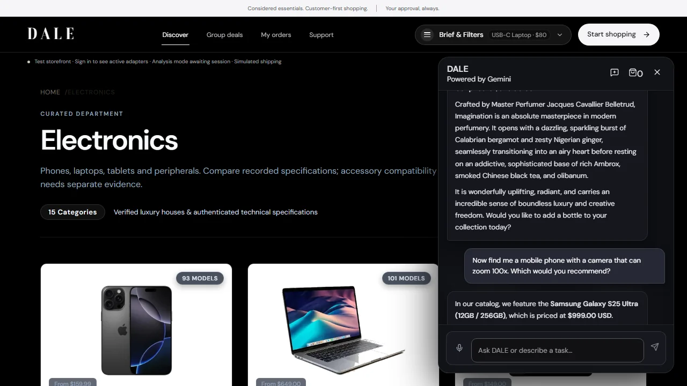
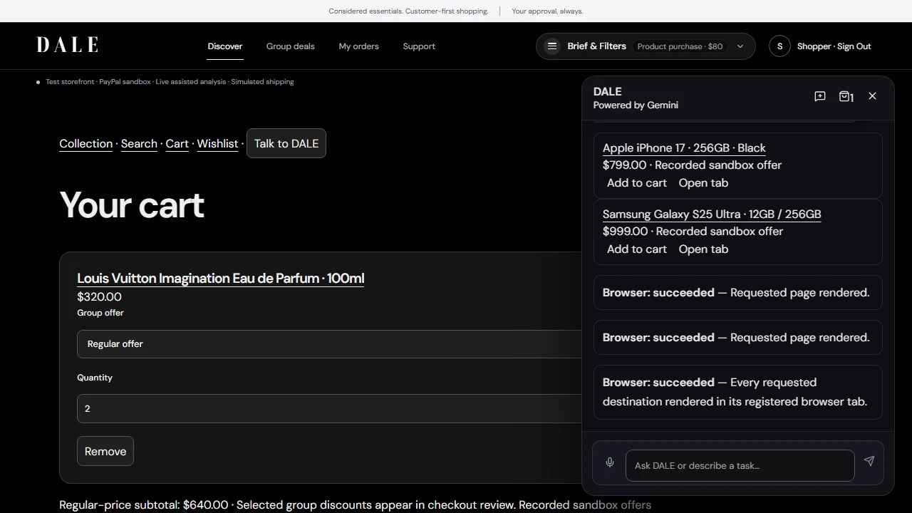
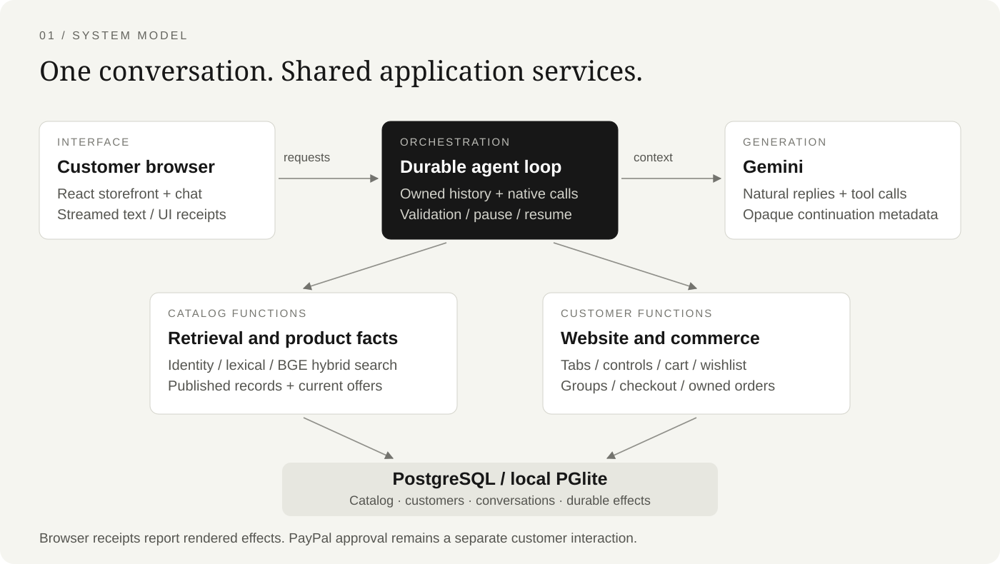
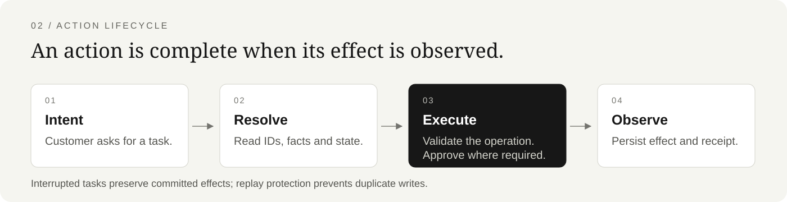
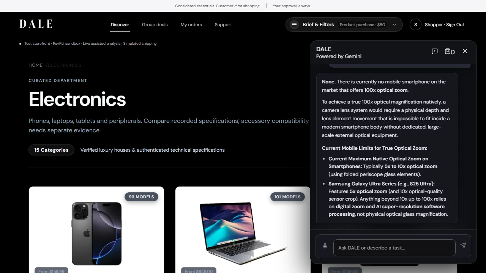

<p align="center">
  
</p>

<p align="center">
  <strong>A conversational shopping agent.</strong><br>
  Built for the PayPal AI Hackathon.
</p>

<p align="center">
  <a href="#capabilities">Capabilities</a> &nbsp; / &nbsp;
  <a href="#system">System</a> &nbsp; / &nbsp;
  <a href="#evaluation">Evaluation</a> &nbsp; / &nbsp;
  <a href="#run-locally">Run locally</a> &nbsp; / &nbsp;
  <a href="#technical-record">Technical record</a>
</p>

DALE connects natural Gemini conversation to a multi-category storefront. The agent can consult the catalog, compare recorded facts, navigate listings, open browser tabs and manage the customer's shopping session. Actions use the application's services and actual interface; conversation history and committed effects survive refreshes.

> “Open those two products in separate tabs. Add my choice to the cart, quantity two.”

## Capabilities

| Customer task               | What DALE provides                                                                                              |
| :-------------------------- | :-------------------------------------------------------------------------------------------------------------- |
| **Discover and compare**    | Catalog identity, specifications, variants, recorded offers and stock through selective retrieval.              |
| **Control the storefront**  | Navigation, category controls, search filters, sorting, pagination and separate product tabs.                   |
| **Manage a purchase**       | Cart, wishlist, quantity changes and checkout review through shared customer services.                          |
| **Buy together**            | Persistent group participation across independent customers and browser sessions.                               |
| **Continue a conversation** | Owned chat history, earlier-message paging, contextual follow-ups and New chat.                                 |
| **Speak a request**         | Microphone input, local transcription and transcript review before sending.                                     |
| **Follow an order**         | Existing customer order, cancellation, return and evidence interfaces; sensitive actions retain approval steps. |

<table>
  <tr>
    <td width="50%"></td>
    <td width="50%"></td>
  </tr>
  <tr>
    <td><sub><strong>01 / Catalog conversation.</strong> Retained local acceptance capture.</sub></td>
    <td><sub><strong>02 / Website actions.</strong> Retained local acceptance capture.</sub></td>
  </tr>
</table>

Manufacturer-linked product facts and DALE's merchant offers are separate. Prices and stock include sandbox data; shipping is simulated. The screenshots document their recorded checkpoints, not a fresh hosted deployment.

## System


_Conversation → catalog context → application action. Conceptual artwork; not an interface capture._

The system is a Next.js modular monolith. Gemini chooses native functions and generates the response. Identity, lexical and BGE semantic retrieval supply catalog context. The agent executor validates operations, retains native continuation metadata and pauses for browser receipts or customer interaction when needed.





| Layer                    | Technology                                                          |
| :----------------------- | :------------------------------------------------------------------ |
| Application              | Next.js 16 · React 19 · TypeScript 6                                |
| Generation and retrieval | Gemini native function calling · local BGE embeddings               |
| Persistence              | PostgreSQL · PGlite for supported local previews                    |
| Interface                | Motion · GSAP · React Three Fiber / Three.js                        |
| Commerce and operations  | PayPal sandbox · Node worker · local/S3-compatible evidence storage |
| Verification             | Vitest · Playwright · bounded live-provider checks                  |

The storefront pairs large editorial typography with an ivory architectural setting and a muted-green footer. Real catalog photographs remain separate from the original generated backdrop, compressed to a 59 KB WebP. Lenis wheel inertia, GSAP scroll scenes and overlapping collection cards give foreground objects, typography and background planes independent movement; outgoing cards recede behind the next collection. The opening starts with staggered glyphs and a layered glass entrance. Nearby letters repel from the pointer and spring back; the background and product follow separate damped springs. Glass edges and shadows supply depth without large backdrop filters. Entrance reveals run once when visible. Lenis runs on demand while interpolation is active. Touch and reduced-motion layouts retain native scrolling and ordinary document flow. Fonts are self-hosted, and the featured product image loads eagerly. Homepage requests open the same conversational agent used throughout the storefront.

## Evaluation

**Recorded local evidence, 21 October 2026.** Counts below describe different scopes and overlap; they are not a combined test total.

| Evaluation scope                               | Recorded result                                                                    | Record                                                                |
| :--------------------------------------------- | :--------------------------------------------------------------------------------- | :-------------------------------------------------------------------- |
| Response-speed implementation                  | 155 distinct targeted contracts; 29 distinct browser journeys across recorded runs | [Qualification ledger](docs/VALIDATION.md#recorded-evidence)          |
| Full Flash camera regression                   | 2/2 live customer requests passed; 68 scoped contracts passed                      | [Agent acceptance report](docs/VALIDATION.md#camera-phone-case-study) |
| Broader repository baseline, before speed work | 579 passed; **19 unresolved failures**                                             | [Regression triage](docs/VALIDATION.md#known-gaps)                    |



_03 / Contextual correction. The customer tightens the requirement to 100× optical zoom. The agent answers “None”; no unrelated product cards or cart changes appear._

The two camera replies completed in **15.9 s and 15.2 s**. The one-second response target is unmet. Streaming reduces buffering, not provider inference time. Whole-marketplace production readiness, external PayPal approval, comprehensive device/accessibility coverage and physical microphone quality remain separate acceptance gates. Local qualification does not certify the hosted build.

<details>
<summary><strong>Reproduce software contracts</strong></summary>

```sh
npx vitest run tests/catalog-rag.test.ts tests/chat-memory.test.ts tests/chat-context-limits.test.ts tests/concierge-model.test.ts tests/concierge-semantic.test.ts tests/concierge-identity.test.ts
npx playwright test --config playwright.chat-memory.config.ts
npm run typecheck
npm test
```

Browser fixtures test application behavior; real-provider checks test the configured model separately. Explicit live commands, prerequisites and evidence boundaries are recorded in the linked ledgers. Private acceptance receipts remain under ignored `.data/concierge-verification/`.

</details>

## Run locally

Node.js 22+ and npm. Configure private local settings as described in [development](docs/DEVELOPMENT.md).

```sh
git clone https://github.com/Hrushikesh-ramilla/DALE.git
cd DALE
npm install
npm run dev
```

Open [localhost:3000](http://localhost:3000). Fixture commerce can run without payment credentials; the conversational agent needs configured Gemini access. Credentials and `.data/` stay outside version control.

<details>
<summary><strong>Configured Gemini preview and retrieval</strong></summary>

With the private provider settings and the existing local runtime prepared:

```sh
node scripts/configure-concierge-local.mjs --provider=gemini
npm run build
node scripts/start-concierge-local.mjs
```

The ignored `.data/concierge.env` profile retains the selected model. Cloud access requires the existing free-quota and billing-disabled confirmations; configuration does not enable billing. Start prepared BGE embeddings in a separate terminal:

```sh
node scripts/start-concierge-embeddings.mjs
```

See [architecture](docs/ARCHITECTURE.md) for configuration and [development](docs/DEVELOPMENT.md) for prerequisites. Keep one process owner per embedded database directory. Stop the preview launcher and its child before rebuilding or running separate database/index maintenance. Do not reset customer data.

Docker Compose is available via `docker compose up --build`; use the matching environment configuration. EC2 scripts provide deployment support, not evidence of the current hosted version.

</details>

## Technical record

- [Architecture](docs/ARCHITECTURE.md) — agent, retrieval, persistence and website actions.
- [Development](docs/DEVELOPMENT.md) — local setup, private configuration and verification.
- [Validation](docs/VALIDATION.md) — recorded evidence and current limits.

`src/app` contains pages and APIs; `src/server/concierge` contains the agent; `src/components/copilot` connects conversation to the browser. Domain contracts live in `src/domain`, catalog records in `catalog`, and reproducible checks in `tests`, `e2e` and `scripts`.

<p align="center"><sub>DALE · Conversational commerce · PayPal AI Hackathon</sub></p>
