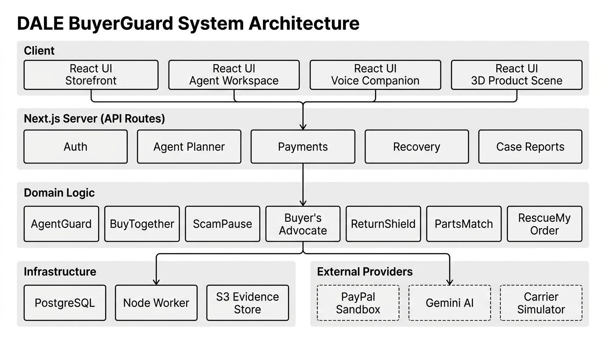
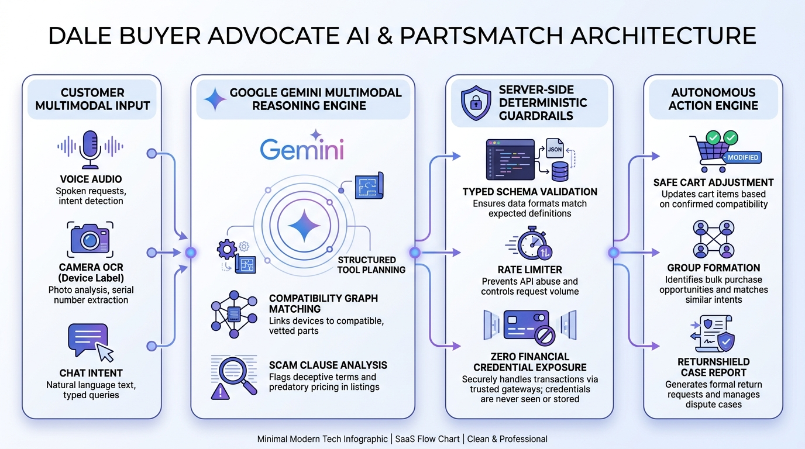
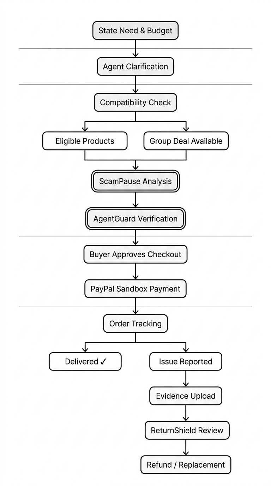
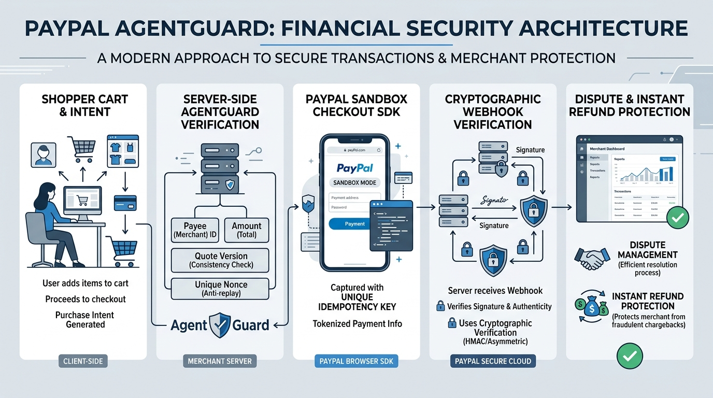
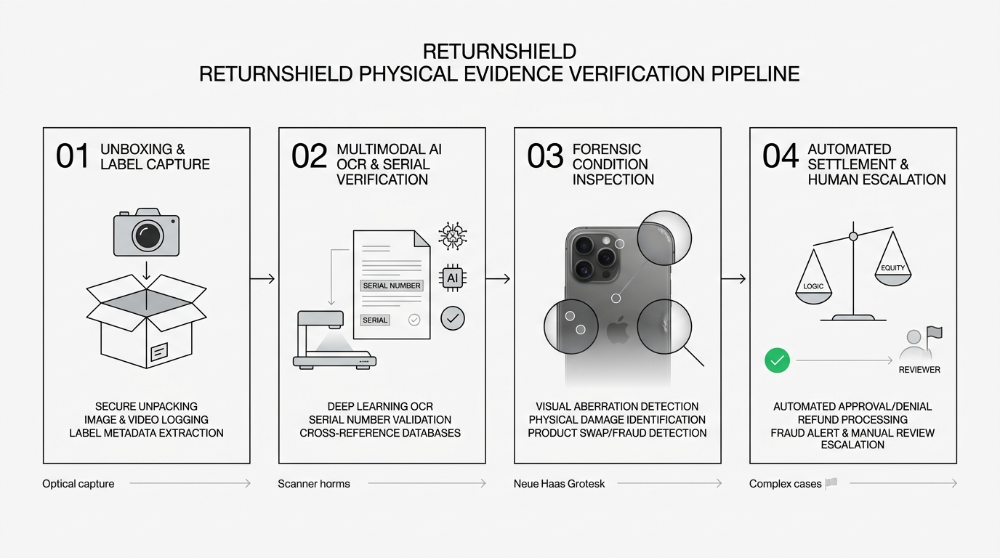

# DALE

A conversational shopping application built for the PayPal AI Hackathon. Explore a multi-category catalog with Gemini, compare products, and use the storefront's customer shopping workflows.

DALE is the product name; `buyerguard` remains the internal package name.

## Current state

The current chatbot combines natural Gemini conversation, durable session memory, and selective catalog retrieval. Gemini can look up published products, specifications, variants, recorded prices, and stock through three read-only functions. It chooses when to retrieve and writes its own answer.

**Conversational website control is implemented and tested locally.** Gemini can request real navigation, separate browser tabs, search filters, component controls, cart/wishlist changes and existing customer workflows. Customer file selection, evidence submission, independent group commitments, checkout review and account changes use the actual customer interface and services. Durable native continuations and observed browser receipts connect these effects to the conversation. See the [verification ledger](docs/WEBSITE_CONTROL_STATUS.md) for measured gates and platform limits.

| Area              | Current behavior                                                                                                                                          |
| ----------------- | --------------------------------------------------------------------------------------------------------------------------------------------------------- |
| Conversation      | Gemini-generated replies; the selected model is configurable.                                                                                             |
| Session memory    | Server-side conversation archive, history paging, New chat, and long-conversation summaries.                                                              |
| Catalog knowledge | Product search, exact-record lookup, and category/brand/attribute discovery.                                                                              |
| Retrieval         | Identity and text search plus the existing local BGE embedding index. Gemini generates answers; BGE supplies search embeddings.                           |
| Storefront        | Multi-category browsing, product pages, filters, cart, wishlist, comparison, and customer commerce interfaces.                                            |
| Commerce          | Backend services for customer identities, groups, payment approval, orders, evidence, and recovery. Each integration has its own validation requirements. |
| Agent actions     | Owner-scoped website tools, durable pause/resume, replay protection, tab registration and observed browser receipts; qualification tracked separately.    |

Manufacturer-linked product identities are separate from DALE's merchant offers. Recorded prices, stock, shipping, and fulfillment include sandbox/simulated data. This repository is not certification of a live commercial marketplace, complete physical-evidence verification, or universal compatibility coverage.

### Verified checkpoint — 21 October 2026

The implemented customer-control checkpoint is `3507760`; its acceptance documentation is saved in `636fbe7`. Natural Gemini conversation, catalog retrieval, session memory and the existing visual design are preserved.

| Check                                                                                     | Recorded outcome                                                                                                                                         |
| ----------------------------------------------------------------------------------------- | -------------------------------------------------------------------------------------------------------------------------------------------------------- |
| Targeted agent, customer-service, retrieval, memory, provider, ordering and restart tests | 108 passed across the qualified runs                                                                                                                     |
| Customer browser journeys                                                                 | 25 distinct journeys qualified: 24 passed together, then the repaired homepage case and four affected journeys passed on the final build                 |
| Voice                                                                                     | Browser microphone transport → local Whisper → transcript review → website action passed using owned synthetic speech; 10 speech HTTP checks also passed |
| Live Gemini                                                                               | 3 tasks passed using the existing `gemini-3.5-flash-lite` configuration: exact listing, quantity/cart navigation and separate observed product tabs      |
| Build and static checks                                                                   | Optimized application build, TypeScript and scoped lint passed                                                                                           |
| Broader repository audit                                                                  | 579 passed, 19 failed, none skipped; see [regression triage](docs/WEBSITE_CONTROL_REGRESSION_TRIAGE.md)                                                  |

**Response/action speed is the next priority.** The latest three live multistep tasks took approximately **41, 47 and 67 seconds**, including model, tool and browser round trips, while other local verification was running. These are small acceptance samples, not latency percentiles or a benchmark of every chat reply. Streaming and latency optimization are not implemented yet. The next work must measure the critical path and improve speed while retaining the verified action, ownership and recovery behavior.

The local checkpoint has been pushed to `codex/conversational-shopping-checkpoint`. The hosted site has not been updated to this checkpoint. Physical microphone quality, a comprehensive device/accessibility/load matrix, external PayPal approval and whole-marketplace production readiness remain separate qualification gates.

Current scope documentation:

- [Catalog RAG](docs/CATALOG_RAG.md): implemented read-only catalog knowledge and evidence.
- [Session memory](docs/SESSION_MEMORY.md): persistence, pagination, summaries, and limits.
- [Implementation plan](IMPLEMENTATION_PLAN.md): approved conversation-based control of the customer website, including multiple browser tabs.
- [AI response speed plan](AI_RESPONSE_SPEED_IMPLEMENTATION_PLAN.md): proposed measurement, streaming and action-latency improvements; no speed changes implemented at this checkpoint.
- [Website-control ledger](docs/WEBSITE_CONTROL_STATUS.md) and [coverage inventory](docs/website-control-coverage.json): actual progress and remaining acceptance gates.
- [Archived catalog implementation plan](CATALOG_IMPLEMENTATION_PLAN_2026-10-11.md): preserved assortment-expansion handover.
- [Original master plan](MASTER_PLAN.md): product goals and historical decisions.
- [Original-plan implementation audit](docs/ORIGINAL_PLAN_IMPLEMENTATION_AUDIT_2026-10-15.md): feature boundaries and remaining qualification.

Historical release notes and completion percentages elsewhere describe their named builds and scopes. They are not a current whole-project production-readiness claim. The hosted deployment may differ from the local checkout.

## Architecture

The application is a Next.js modular monolith with shared TypeScript domain services, PostgreSQL persistence, and an optional background worker. Local previews can use embedded PostgreSQL through PGlite.

```text
Browser / React
    |
    +-- Storefront controls --> Application services --> Database
    |
    +-- DALE conversation --> Session memory --> Gemini
                                               |
                                               +-- Catalog functions
                                                        |
                                                        +-- Published catalog
                                                        +-- Local search embeddings
                                               +-- Customer website functions
                                                        +-- Durable execution / shared services
                                                        +-- Registered browser tabs / rendered-page receipts

Commerce services --> PayPal sandbox / evidence storage / recovery worker
```

The following diagrams document the broader product architecture and original commerce journeys; they do not mean every workflow is connected to the current chatbot.





## Original product capabilities

The original seven capabilities remain the product's broader direction. Their presence in the codebase and historical scenario tests should be assessed separately from current live acceptance.

| Capability       | Purpose                                                                                      |
| ---------------- | -------------------------------------------------------------------------------------------- |
| AgentGuard       | Bind payment operations to server-owned items, amounts, currency, payee, and approval terms. |
| BuyTogether      | Same-product group discounts with independent customer participation and checkout.           |
| ScamPause        | Advisory analysis of voluntarily supplied messages and listing content.                      |
| Buyer's Advocate | Help customers discover and compare products according to their preferences.                 |
| ReturnShield     | Evidence collection, claim review, remedies, and case reporting.                             |
| PartsMatch       | Supported device/accessory compatibility checks with recorded evidence.                      |
| RescueMyOrder    | Customer-selected recovery for late or canceled orders and uncertain provider outcomes.      |

Evidence integrity establishes which bytes were submitted; it does not prove the truth of a scene or automatically establish fraud. Compatibility, model quality, payment completion, and deployment each require their own evidence.




## Technology

| Layer              | Stack                                                          |
| ------------------ | -------------------------------------------------------------- |
| Application        | Next.js 16, React 19, TypeScript 6                             |
| Data               | PostgreSQL; PGlite for supported local previews                |
| AI conversation    | Configurable Gemini API adapter with native function calling   |
| Retrieval          | Catalog identity/text matching and local BGE embeddings        |
| UI                 | CSS, Motion, GSAP, React Three Fiber / Three.js                |
| Payments           | PayPal sandbox integrations                                    |
| Jobs and evidence  | Node worker; configurable local/S3-compatible evidence storage |
| Testing            | Vitest, Playwright, and scoped evaluation scripts              |
| Deployment support | Docker, Ubuntu EC2, Caddy, systemd                             |

## Local development

Use Node.js 22 or newer and npm. Provider credentials are optional for fixture-based application tests, but the real Gemini chatbot needs configured Gemini access.

```sh
git clone https://github.com/Hrushikesh-ramilla/DALE.git
cd DALE
npm install
cp .env.example .env
npm run dev
```

Configure the required session/operator settings described in [`.env.example`](.env.example). Open [localhost:3000](http://localhost:3000). Fixture commerce settings do not substitute scripted replies for a missing real chatbot provider.

For the existing configured Gemini preview:

```sh
node scripts/configure-concierge-local.mjs --provider=gemini
npm run build
node scripts/start-concierge-local.mjs
```

The local profile is stored in ignored `.data/concierge.env`. Gemini generation requires the configured key/model and explicit cloud/free-quota/disabled-billing settings. Never commit the profile or `.env`. The current launcher supervises the preview process; stop its launcher as well as its child before rebuilding.

The existing embedding service can be started separately after its model/runtime setup:

```sh
node scripts/start-concierge-embeddings.mjs
```

See [catalog RAG](docs/CATALOG_RAG.md) and the setup scripts for retrieval configuration. Keep one owner per embedded database directory; close the application before running a separate indexing/database process against the same directory. Never reset customer data to prepare a preview.

Docker Compose is also available:

```sh
docker compose up --build
```

Use deployment/environment configuration appropriate to the selected mode. Existing EC2 scripts are deployment support, not evidence that this checkout is currently deployed.

## Verification

The latest catalog-RAG acceptance on 20 October 2026 passed **46 targeted tests**, **two packaged-production browser journeys**, TypeScript, scoped lint, and separate live Gemini checks. Those live checks included actual catalog lookups, product prices, a follow-up, and a camera-phone request. The semantic index refresh covered **4,510 published records**; that is an observed published count, not a promise about every historical or unpublished record.

```sh
# Current conversation, retrieval, and provider contracts
npx vitest run tests/catalog-rag.test.ts tests/chat-memory.test.ts tests/chat-context-limits.test.ts tests/concierge-model.test.ts tests/concierge-semantic.test.ts tests/concierge-identity.test.ts

# Browser contracts against a prepared production artifact
npx playwright test --config playwright.chat-memory.config.ts

# Broader repository checks
npm run typecheck
npm test
npm run lint
```

The latest broader repository audit recorded **579 passed, 19 failed, and none skipped**. Its repository-wide gate is still failing; targeted agent acceptance does not supersede it. See [current regression triage](docs/WEBSITE_CONTROL_REGRESSION_TRIAGE.md) for the remaining catalog/media/publication failures. The earlier **532 passed, 28 failed, and 11 skipped** result in [the historical checkpoint audit](docs/CHECKPOINT_2026-10-20.md) is the pre-implementation baseline, not the latest result.

Browser fixtures validate application behavior. Live-provider checks validate the configured model separately; neither alone establishes production readiness. Reproduce and inspect results against the checkout being assessed.

Explicit bounded live checks are available when the configured free provider is usable:

```sh
npx tsx scripts/verify-catalog-rag-live.ts --live
npx tsx scripts/verify-chat-memory-live.ts --live
```

They preserve the configured model and billing policy. Provider quota and availability still apply. Verification receipts under `.data/concierge-verification/` stay local and are not committed as customer data.

## Repository map

- `src/app/`: storefront pages and API routes.
- `src/components/copilot/`: conversation UI, state, and existing browser-action bridge.
- `src/server/concierge/`: Gemini adapter, catalog RAG, session memory, and shopping/action foundations.
- `src/domain/`: product, category, compatibility, and commerce contracts.
- `catalog/`: manifests, source/revision information, and media review data.
- `public/images/`: published website assets.
- `tests/`, `e2e/`: unit/contract and browser verification.
- `scripts/`, `deploy/`: ingestion, verification, preview, and deployment support.
- `docs/`: architecture, plans, audits, and historical acceptance records.

Credentials, private databases, customer evidence, and temporary downloads belong outside version control.
