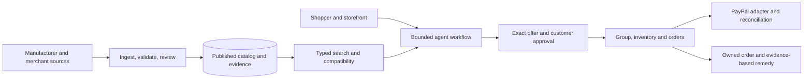

# DALE marketplace expansion: implementation specification

Prepared 11 October 2026. Status: implementation in progress. The additive publication/search foundation and first exact-product manifests are deployed and verified in application 9547200. Preserve existing customer data and original MASTER_PLAN.md feature contracts; the complete assortment and scale requirements below remain acceptance targets.

## 1. Product and release objective

DALE is a customer-first commerce agent operating over a substantial managed marketplace. The shopper can describe a task, receive evidence-linked comparisons across departments, refine constraints, join an exact-product group, approve an immutable offer and receive help with the resulting order or return. The catalog and storefront make that task useful and testable.

The expansion must prove all seven original capabilities at meaningful assortment depth: AgentGuard, BuyTogether, ScamPause, Buyer's Advocate, ReturnShield, PartsMatch and RescueMyOrder. Every new category extends their typed data contracts and evaluations. A large storefront without those connected workflows fails acceptance.

First broad-catalog target: 2,000 verified distinct products across 12 priority departments, with exact variants counted separately. The first release gate is the approved manifest's actual counts and depth, not a generated round number. Longer-term envelope: 5,000-10,000 products and 20,000-50,000 SKUs, conditional on source access, media delivery and load tests. These are capacity/design targets, not current inventory or traffic claims.

Minimum depth: phones/laptops aim for 10-15 distinct models per selected brand; approved audio brands aim for ten where they actually offer sufficient documented models in that category; clothing, fragrances, watches and selected eyewear houses aim for at least ten distinct products each. No invented identities, archive relabelling or colour/size inflation to satisfy a target. Publish a shortfall report whenever manufacturer supply or source access cannot support the target; do not silently substitute unknown brands.

## 2. Current baseline and required changes

Proposed first broad-catalog allocation (distinct products, not variants):

| Priority department | Target | Depth rationale |
| --- | ---: | --- |
| Phones and tablets | 200 | At least 90 phone models from the nine selected houses where verified; separate tablet/e-reader sourcing |
| Computers | 300 | At least 90 laptop models where verified; monitors, peripherals, storage, networking and components separately sourced |
| Audio | 180 | Headphones, earphones/earbuds, speakers/soundbars and microphone types with category-specific brand depth |
| Clothing | 160 | Ten distinct products from each of the 16 selected houses |
| Fragrance | 120 | Ten named products from each of the 12 selected houses |
| Watches | 100 | Ten distinct exact references from each of the ten selected houses |
| Footwear | 100 | Selected brands plus a separate remaining-brand manifest; exact size variants not counted |
| Sunglasses and eyewear | 100 | Ten selected houses from the 20-brand shortlist, ten distinct frame models each |
| Beauty and care | 100 | Ten source-approved luxury houses, ten distinct products each |
| Bags and luggage | 100 | Exact products across approved houses and useful carry types |
| Home and kitchen | 300 | Separately reviewed cookware, tableware, storage, textile, lighting and furniture records |
| Appliances | 240 | Category-specific manufacturer/model manifests and technical comparisons |
| **Total** | **2,000** | Source/approval/media shortfalls are recorded; never manufacture inventory to reach this allocation |

Allocation is a proposed target, not an assertion that all those records are available, current-year releases or approved already. The manifest gate establishes the actual supported counts and any supply shortfalls before import.

| Area | Inspected implementation | Required expansion |
| --- | --- | --- |
| Navigation | Six departments, 13 broad category IDs | Hierarchical database-backed taxonomy, typed product types, category-specific brand manifests |
| Public inventory | 35 source-linked records selected by static publicCatalog | Versioned publication status in the database; no production ID allowlist tied to a code deployment |
| Catalog startup | catalog-store.ts upserts bundled records on first use | Explicit import/seed jobs; ordinary reads never overwrite imported inventory |
| Search | Substring name search, JSONB containment, offset pagination; 48 records/page | Indexed full-text and exact attributes, relevance/price sorts, facets, stable cursors and query plans |
| Product access | Bundled model registry and productById usages | Async authoritative product service; pure validators take resolved records; static registry reserved for fixtures |
| Accounts/groups/orders | Persistent accounts/sessions and shared PostgreSQL workspace state exist | Reuse identity/ownership guards; measure shared-state contention and add transactional records for hot inventory/group paths where necessary |
| Background work | PostgreSQL jobs, leases, retries and worker heartbeat exist | Separate ingest/media/refresh job types, idempotent batches, dead-letter review and per-origin concurrency |
| Media | Branded text cards; original illustrations in the hero | Verified exact-product photography, rights records, responsive image derivatives and tested delivery |
| Release | Checked Linux artifact, checksums, database snapshots, systemd app/worker | Add migration, import, data-quality, load, media and multi-category release gates |

Inspected 11 October via restricted SSH: two CPUs, 1,905 MiB RAM, no swap, approximately 1.9 GiB free root disk. This is the observed deployment baseline, irrespective of an earlier requested instance size. Do not claim 4 GiB or greater capacity until measured. Preserve existing inference/provider configuration and the no-new-spend instruction. The plan neither provisions infrastructure nor introduces an untested model dependency.

## 3. Assortment and navigation scope

Original feature contracts carried into the expanded assortment:

| Capability | Concrete expanded-store behavior |
| --- | --- |
| AgentGuard | Source/price changes and untrusted seller text cannot bypass tool validation or explicit customer approval |
| BuyTogether | Independent shoppers join one exact SKU/merchant/terms group; variants and private accounts cannot be merged incorrectly |
| ScamPause | Review suspicious seller/payment messages across departments; explain uncertainty and never promise authenticity from a logo/image |
| Buyer's Advocate | Preserve hard constraints and customer priorities; disclose missing evidence, exclusions and meaningful tradeoffs |
| ReturnShield | Compare ordered exact variant to customer/seller evidence, retain checkpoints, customer-selected remedies and human review |
| PartsMatch | Resolve exact devices and prerequisites before suggesting chargers/cases/docks/lenses; unknown compatibility remains unknown |
| RescueMyOrder | Retrieve the shopper's own order and next permitted status/support/remedy action, with receipts and retained context |

| Priority | Department | Separate category/type pages |
| --- | --- | --- |
| A | Phones and tablets | Phones, foldables, tablets, e-readers; brand/model pages; linked phone/tablet accessories |
| A | Computers | Laptops, desktops, monitors, keyboards, mice, storage, networking, printers, components; linked laptop accessories |
| A | Audio | Headphones, earbuds, wired earphones, in-ear monitors, speakers, soundbars, microphones; linked audio accessories |
| A | Clothing | Shirts, T-shirts, knitwear, trousers, denim, dresses, suits, jackets, coats; label and size-system filters |
| A | Fragrance | Named perfumes, concentration, bottle sizes and separately identified gift sets |
| A | Watches | Mechanical, quartz and dress/sport types; exact reference numbers; electronic smartwatches under electronics |
| A | Footwear | Loafers, formal shoes, sneakers, running shoes, boots, sandals and heels |
| A | Sunglasses and eyewear | Everyday, aviator, square, round, cat-eye, wrap/sport, polarized and documented prescription-eligible types |
| A | Beauty and care | Skincare, makeup, haircare, bodycare and tools |
| A | Bags and luggage | Handbags, totes, crossbody bags, backpacks, wallets, luggage and travel accessories |
| A | Home and kitchen | Cookware, tableware, textiles, organization, lighting and dimensional furniture |
| A | Appliances | Kitchen, cleaning, laundry and documented personal-care appliances |
| B | Cameras and gaming | Cameras, lenses, consoles, controllers and related accessories |
| B | Sports and outdoors | Equipment, clothing, backpacks and dimensional/technical gear |
| B | Books, stationery and games | Books, notebooks, writing instruments, board games, toys and documented age guidance |
| B | Tools and automotive accessories | Hand/power tools, parts and exact documented vehicle fitment |
| B | Household, pantry and pet supplies | Label-based browsing, quantities, ingredients and documented restrictions; no medical/pet-treatment recommendations |

Priority A is the first broad storefront target; B is an explicit subsequent assortment, not hidden abandoned work. Additional supplier-dependent categories stay in the roadmap with sourcing blockers and next actions. Empty departments are not exposed as completed shopping destinations.

The UI can group phones/computers/audio under Electronics while retaining separate leaf catalogs and filters. Department -> category -> product type is the browse hierarchy; customers may jump directly via search or the agent. Use breadcrumbs, deep links, brand filters, pagination, comparison tray and exact-variant selection. Product detail pages carry real images, source-linked specifications, offer terms, compatible accessories and group eligibility. Preserve the accepted monochrome design; category pages must be distinct through content and relevant attributes rather than unrelated visual redesigns.

The global agent remains visible while browsing. It can link directly to filtered category results and comparison cards; category clicks must retain the conversation. Filters and chat refinements share a versioned search state, with visibly retained constraints and an explicit reset. Do not silently carry a laptop compatibility profile into clothing or sunglasses.

## 4. Sunglasses assortment and comparison contract

Explicitly selected: Oakley, Ray-Ban. Additional selection candidates: Persol, Maui Jim, Oliver Peoples, Jacques Marie Mage, DITA, Cutler and Gross, MOSCOT, Garrett Leight, MYKITA, LINDBERG, Gentle Monster, Cartier, Tom Ford, Prada, Gucci, Saint Laurent, Bottega Veneta, Chanel. Import only exact reviewed models; fashion-house eyewear manufacturer/licensee names are retained where relevant.

Initial manufacturer examples for manifest research: Ray-Ban Original Wayfarer, Aviator and Clubmaster; Oakley Holbrook; Persol 714. These establish actual catalog references, not the complete ten-model manifests.

Sources checked for this plan:

- [Ray-Ban iconic sunglasses](https://www.ray-ban.com/usa/sunglasses/icons?pageNumber=1)
- [Oakley Holbrook model/lens record](https://www.oakley.com/en-us/product/888392642011)
- [Persol 714 collection](https://www.persol.com/usa/icons-collection-714-series/)
- [Maui Jim polarized sunglasses](https://www.mauijim.com/polarized-sunglasses.html)

Schema: manufacturer model/reference, frame shape/material/colour, lens width, bridge width, temple length in millimetres, stated fit label, lens material/tint, polarization, documented visible-light transmission/category, UV claim evidence and prescription eligibility. Unknown fields remain unknown; a protection claim must reference the exact manufacturer record and variant. Polarization, tint and UV protection are separate fields. No general brand-level claim automatically overrides a model-specific conflicting source.

Agent examples: find documented polarized frames within a budget; compare two exact references by dimensions/material; seek a wider frame using stated dimensions; explore sports versus everyday styles. Face-shape preferences can guide suggestions, but dimensions do not establish guaranteed personal fit. A product recommendation does not verify a seller's authenticity or substitute for prescription advice. Smart glasses are one SKU cross-listed with Electronics and carry electronic specifications in addition to eyewear attributes.

## 5. Data model and migration

Keep a modular monolith: existing Next.js/TypeScript application, PostgreSQL and background worker. Bound module ownership: catalog/taxonomy, ingestion/provenance/media, search, agent orchestration, identity, commerce/group/inventory, payments and recovery. APIs communicate through typed application services; avoid direct client imports of authoritative inventory. Split deployment services only when profiling and operational needs justify it.

| Entity | Key invariant |
| --- | --- |
| brand / brand_alias | Canonical identity and explicit label/ownership relationships; preserve display spelling |
| category / category_schema | Stable ID, parent, allowed attribute keys, units and schema version; no taxonomy cycles |
| product_model | One manufacturer model/reference per region/edition where those alter facts; release date separate from reviewed date |
| sku_variant | Exact manufacturer reference plus size/colour/capacity/lens/concentration configuration; unique normalized variant key |
| product_fact / source_observation | Field-level fact, value/unit, source URL, region, observed time, conflict/staleness state |
| media_asset | Exact product/variant association, source, rights/attribution, content hash, dimensions and derivative status |
| merchant_offer | Seller, SKU, price in minor units, currency, stock/delivery/return terms, freshness and offer version |
| compatibility_edge | Device and accessory identities, verdict, prerequisites, supporting observations and review status |
| catalog_release / import_batch | Immutable manifest version/hash, approval record, validation report, staging/published/retired status |
| inventory_reservation | Offer/SKU quantity, owner, expiry and state; transactionally checked stock |
| group / group_commitment | Exact SKU, merchant/currency/terms, cutoff and discount version; unique active commitment per participant |
| order / payment_attempt / remedy | Immutable approved snapshot, ownership, idempotency and audit references preserved |
| outbox_event | Durable events committed with the originating mutation; retries cannot duplicate business effects |

Use normalized columns for keys and hot typed filters, JSONB for sparse category attributes, indexed full-text documents for names/aliases, and constrained decimal/unit parsing. Do not turn every arbitrary seller string into a trusted searchable fact. Migrations are versioned, additive and tested against a copy of the existing schema. Never drop or renumber historical B/R/P/L identities. Provide an old-ID mapping and resolved-record adapter so existing quotes/orders retain their original meaning.

Introduce catalog release pointers and publication queries before removing static allowlists. Import to staging; atomically publish a validated batch; retire records for future discovery without deleting order references. Historical order line items retain approved names, attributes, price/currency, merchant and terms independently of subsequent catalog edits. Fixtures remain isolated and reproducible.

## 6. Ingestion and product media pipeline

1. Build an exact-product manifest by category/brand with source URLs, manufacturer references, region and intended model count. Record approval and shortfalls explicitly.
2. Prefer manufacturer feeds/approved merchant feeds; use reviewed public manufacturer retrieval where permitted. Retain origin allowlists, bounded redirects/timeouts, response-size limits, per-origin concurrency and backoff. Do not use private-network URLs from seller inputs.
3. Parse with category-specific extractors. An LLM may propose extraction, but authoritative publication requires schema validation and source evidence; ingestion is also runnable without paid inference.
4. Normalize units, identifier/alias mappings, category variants and currencies. Check duplicates and contradictions, and route uncertain records to an operator review queue.
5. Collect permitted exact-product media. Validate file type/dimensions, remove irrelevant metadata, create bounded responsive derivatives and link the correct SKU/model. Persist rights evidence and source attribution. No invented generic bottle/phone image standing in for a named real item.
6. Stage catalog records and media together; run validation, representative UI and agent tests; atomically publish the version. Interrupted imports resume by idempotent batch/record keys, not by reseeding all data at application startup.
7. Refresh on category/offer policies, detect upstream changes and retain old source observations. Failures keep the last known record marked stale, rather than inventing a fresh value.

Starting freshness targets, subject to feed availability: merchant price/stock 5-15 minutes for integrated feeds; manual/sandbox offers always disclose their nature; source-linked specifications rechecked weekly; release/lifecycle status checked daily during a new-model launch. These intervals are planned worker policies, not promises that a missing feed exists. Expired offer data requires reconfirmation before a financial action.

Images need a storage budget. At 2,000 models x four images x three variants x an illustrative 80 KiB average derivative, media is approximately 1.83 GiB before originals, backups and application disk use. Do not fill the current 1.9 GiB free root disk. Start with permitted external image delivery where reliable or a tightly capped licensed asset batch, measure usage and document caching. Object storage/CDN is a later approval/cost decision; unavailable media blocks publication of a product promoted visually and remains visible in the operator report.

## 7. Search and catalog delivery

Catalog API filters: category/type, canonical brand, exact attribute predicates, budget/currency, availability and source completeness. Return a bounded page, cursor, facet counts, catalog/offer version and freshness. Sort by relevance, price and objectively documented attributes. Context-specific recommendation ranking remains a separate agent output with explanations; do not call unconfirmed browse results a personal recommendation.

Use PostgreSQL full-text indexes with reviewed aliases and exact identifiers, alongside category/brand/price indexes and typed attribute indexes justified by EXPLAIN plans. Keyset cursors include sort keys and release version; no duplicate or skipped rows under a changing catalog. Keep legacy page-number APIs through a compatibility adapter until clients migrate. Bound candidate selection to an initial 100 records, result pages to 24-48, comparisons to eight exact variants and final agent shortlist to five. Complex multi-category tasks retrieve each category separately before joining results.

Caching is bounded by memory, tenant/public scope, query and catalog version. Public facts may be cached across users; conversations, quotes, orders and evidence never share a public cache key. Add an optional search index only if measured retrieval limits justify it; PostgreSQL is the first deployment target. Every imported product must be reachable through queries and product URLs without a code redeployment.

## 8. Agent orchestration and evidence

Agent workflow: interpret task -> ask material clarifications -> execute bounded typed retrieval/compatibility/group tools -> check constraints deterministically -> present source-backed options and missing facts -> receive explicit approval -> perform the owned commerce operation -> retain the outcome receipt and assist after purchase.

Persist versioned task state with category-specific constraints, user priorities and clarification history. Examples include a phone plus compatible charger, wide polarized sunglasses, a specific watch diameter, size-chart-based footwear or a fragrance concentration/volume. Multi-item tasks produce separate line items and a calculated combined budget; group savings apply only to the actual compatible group terms, not an invented universal discount.

Model-generated plans cannot fabricate tool results, silently relax hard constraints, change price/currency, impersonate another shopper or approve purchases. Treat descriptions, seller messages, source pages and images as untrusted data. Provide per-turn tool/request/timeout limits and retain receipts. Missing live inference must be visibly distinguished from fixtures; fixture success is not live-model acceptance.

Compatibility is fits / does-not-fit / unknown, with source observations and prerequisites. Sunglasses/footwear/clothing sizing is suggested by documented dimensions/charts, not guaranteed personal fit. Fragrance enjoyment, sound quality and aesthetic preference remain subjective unless separately attributed evidence is supplied. Skincare ingredient comparisons are factual; allergy/medical guarantees are unsupported. Model evaluation includes unseen paraphrases, unknown attributes and contradictory sources, not only approved demo sequences.

## 9. Commerce and multi-customer correctness

Reuse existing owned sessions/accounts, PayPal adapters and approval gates. For scaling, make stock checks, reservations, exact-SKU commitments and group transitions transactional. One canonical SKU can be cross-listed without creating separate inventory. Never merge different frame/lens variants, shoe sizes, laptop configurations or watch references into a discounted group.

Group thresholds count independent active shoppers and persist across browsers/restarts. Guests get stable private identity; guest-to-account linking cannot double-count participation. Finalization freezes eligible terms; every buyer still separately approves their own payable amount. Group pricing changes, stock shortages, expiry or a different SKU require a new quote/approval. Concurrency and retry tests must show no overselling or duplicated capture.

Use unique idempotency keys and durable outbox events for quote/order/payment/group transitions. Validate signed provider webhooks, deduplicate receipts and reconcile pending states. The approved currency is immutable; reference INR prices are not silently submitted as USD. Country/currency/provider capability checks are performed before presenting a payable offer. The current sandbox merchant limitation remains a separate release gate.

Returns retain original-order identity, exact expected SKU/serial where available, upload hashes/timestamps and customer/seller checkpoints. Image/vision analysis supplies observations and uncertainty, not proof of fraud or an automatic denial. Customer-selected remedies, human review, appeal and party authorization remain enforceable. Real refund/capture acceptance is labelled separately from simulated tests.

## 10. Operations and deployment

Security gate: customer, seller, reviewer and catalog-operator permissions are enforced server-side. Retain same-origin mutation checks, session rotation/expiry, secret storage and request/upload limits. Test object ownership for every order/evidence/group action; public indexes and media cannot expose private receipts, photos or conversations. Separate public product media from private evidence storage. Validate ingestion and upload destinations against private-network access; privileged publish/retire actions require auditable operator identity. No generated plan or external listing grants new access or financial authority.

Track structured request/job/agent trace IDs, query duration, worker lag, source age, media failures, catalog rejection counts, order/payment transitions and pool pressure. Redact secrets and private evidence. Operators receive import diff/review, publish/retire, refresh, media-rights, stale-offer and failed-job views with least-privilege roles and audit trails.

Expose liveness separately from readiness. Readiness covers database, current catalog version and essential dependencies; an optional source refresh outage does not erase browsing. Timeouts/circuit breakers isolate slow feeds and inference. Retry only idempotent work; dead-letter entries retain next action and error classification. Set account/session/evidence retention and restore procedures explicitly before real customer operation.

Current single-instance deployment is a sandbox release target with documented single-host failure risk. It does not establish high availability or Amazon-scale throughput. Production commercial operation later needs independent durable backups, object storage, managed database/failover, multiple app replicas and a tested provider/merchant arrangement. Those are distinct readiness gates and require actual resources/budget decisions; this plan does not purchase them.

For the current instance, run measured workloads before promising thousands of simultaneous customers. Cap database connections across app/worker, ingest concurrency and image transformations. Run import/derivative generation off the serving instance where permitted; only validated artifacts/records are installed. Pause nonessential ingestion under disk/memory pressure. Optimize after profiling; do not introduce Kubernetes, multiple queues or a large search cluster solely to sound enterprise-grade.

Release: expand-compatible schema -> stage and validate batch -> publish catalog version -> deploy checked Linux app where code changes require it -> verify public routes and assets -> perform two-device group/order tests -> restart and confirm persistence. Preserve the previous application and catalog version plus a backup. Revert publication pointers where data-only rollback is compatible; retain completed orders/audits and execute an explicit recovery procedure for incompatible data changes.

## 11. Acceptance tests and capacity targets

Agent evaluation pack: at least 240 held-out tasks (20 per priority department), supplemented by category-specific compatibility and variant cases, ambiguity, source failures and adversarial instructions. Proposed targets: at least 95% correct tool/task completion on supported requests and at least 98% source-supported factual claims, with zero hard constraint, privacy or unapproved-financial-action violations in the acceptance pack. Judge against independently reviewed source/expected-result records, not an LLM's self-assessment. Publish failed cases and the fixture/live model versions; these thresholds do not imply universal correctness.

Targets below are new release criteria, not recorded results. Benchmark record count, hardware, concurrency, duration, cache state and fixture/provider mode with each result.

| Gate | Required evidence |
| --- | --- |
| Sourced inventory | Every published identity has a reviewed manufacturer reference/source; required typed attributes validated; unknowns disclosed; approved counts and shortfalls reported |
| Media | Every promoted product has verified exact-product media and usage record; responsive delivery, 404/timeout fallback and no layout overflow tested; no generic visual presented as the real item |
| Migration | Existing customer/order/group/evidence IDs retained; rerunning migrations/imports produces no duplicate inventory; rollback and backup restoration executed |
| Search correctness | Exact reference/alias tests, facet/filter/sort consistency, stable pagination, constraints before ranking and missing/conflicting evidence cases pass |
| Agent | Unseen category-specific tasks, retained follow-up constraints, citations, ambiguity/refusal, source injection and unauthorized-action tests; every hard money/ownership/compatibility invariant passes |
| Accessory graph | Known compatible/incompatible/unknown pairs across actual device models; required cables/protocols included; no USB-C-only or brand-only fit inference |
| Independent shoppers | Three isolated browser contexts: accounts/guest conversion, live commitments, exact-SKU group threshold, private order/evidence ownership and expiry/cancellation |
| Inventory/payments | Concurrent last-unit attempts, retries, duplicate/out-of-order webhooks, provider timeout, stock/price change and reconciliation; no duplicate reservation/order/capture |
| Recovery | Damaged/wrong/missing item, conflicting photos, own-order remedy, human review/appeal and restart persistence; simulated versus genuine outcomes distinguished |
| Initial API performance | On a 2,000-product/10,000-SKU test dataset: 20 concurrent read clients for 15 minutes, p95 catalog/search <=500ms, errors <1%; record cold/warm metrics and SQL plans |
| Resource margin | No OOM or uncontrolled queue growth; steady-state memory below 80% of measured capacity; at least 20% disk free and sufficient measured backup/staging space; pause ingestion if breached |
| Frontend | Representative department/category/detail flows at mobile/desktop, keyboard access, retained agent state, image failures and no full-catalog client payload; LCP <=2.5s and CLS <=0.1 in a declared test profile |
| Release | Checks and production build pass; exact hosted app/catalog version reported; public TLS/media smoke pass; actual restart and database restore/persistence evidence recorded |

Synthetic load data is explicitly separated from source-reviewed public products and cannot inflate public inventory counts. Do not use the agent's own output as its ground truth. Maintain fixed source/evidence labels and held-out tasks reviewed independently of the prompt implementation. Live-model and genuine-provider checks have separate pass/fail/blocked statuses; no fixed percentage masks a failed gate.

## 12. Milestones and reporting

| Milestone | Reviewable output | Completion condition |
| --- | --- | --- |
| M0 — Architecture and scope | This specification, approved brand list, dependency/shortfall log | Written plan connected to original contracts; current-state audit recorded |
| M1 — Product manifests | Exact models per category, source/region/release metadata and media access | Approved IDs/counts; shortages and rights/feed dependencies explicit |
| M2 — Catalog foundation | Typed taxonomy, migration/adapters, staging/publish/import and operator review | Existing histories preserved; rerun/rollback/import tests pass |
| M3 — Electronics depth | Phones, laptops, headphones/earbuds and compatible accessories | Verified model counts, actual media, query/compatibility tests and hosted sample flows |
| M4 — Fashion and lifestyle depth | Clothing, fragrance, watches, footwear, sunglasses, beauty and bags | Category-specific attributes, genuine product media, variant/uncertainty tests |
| M5 — Broad assortment | Home/appliances and subsequent approved departments | Published nonempty reviewed categories and actual manifest counts |
| M6 — Connected agent commerce | Cross-category tasks, shared groups, approval, owned orders and remedies | Independent-device journeys and all original feature invariants pass |
| M7 — Operational release | Load/restore/security/hosted evidence and engineer acceptance pack | All required gates pass; remaining commercial/provider gates reported distinctly |

Each completed implementation milestone has its own professional commit, source/count receipt and tested application/catalog version. Progress reports state completed milestones and remaining gates; any percentage is scoped to a named release and calculated from its acceptance checklist, not a guessed fraction of the entire project.

Current expansion state: M0 is documented. M1 has nine reviewed brand batches and 142 published offers / 138 distinct families; the complete per-brand target remains pending. M2 has additive publication, immutable staging/publish/withdrawal/restoration, full-text search, facets, filter-bound cursor paging and imported commerce/history adapters. The 500-record lifecycle and isolated 10,000-record capacity contracts pass; durable ingestion/refresh, reviewed revisions and commercial load gates remain pending. M3-M5 assortment depth remains partial. M6 passes independent-customer imported watch/group/order journeys and exact phone/fragrance tasks; broader live agent qualification remains separate. M7 has deployed application 9547200 with 20 hosted and 8 actual restart checks; a 50-request read-only burst against 142 records does not close the commercial load target. Do not reset completed payment/account/recovery features. CATALOG_ACCEPTANCE.md records the exact release evidence.
